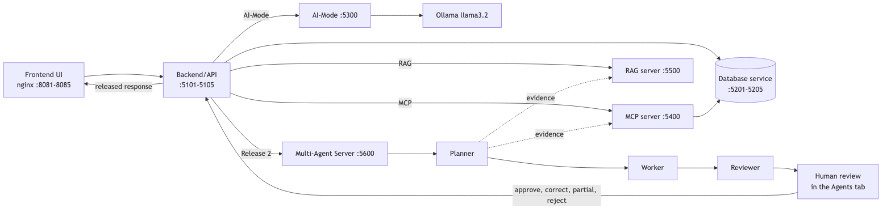
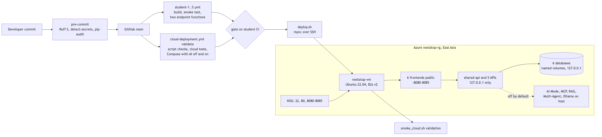

# Release 2 Technical Report - Group 25

**41026 Advanced Software Development, Spring 2026**
**Project NextStop - Agentic AI travel planning application**

---

## Project Overview

NextStop is an agentic AI travel planning application. Each of the five students owns one feature with its own frontend, backend/API and database microservice.

| Student | Name | Feature |
|---|---|---|
| 1 | Caroline Zhou | Trips & Itinerary |
| 2 | Kevin Kim | Attractions & Dining |
| 3 | Tanishpreet Kour | Travel Mate |
| 4 | Aurelia Sari | Account, Dashboard & Travel Guides |
| 5 | Aung Ko Khaing | Bookings & Budget |

Release 1 delivered the 18-container application with AI-Mode, MCP, RAG and the shared agentic loop running on the host. Release 2 extends it without replacing anything: a shared non-containerised Multi-Agent Server used by every feature's new Agents tab, three new agentic-loop review modes (Multi-Agent, Testing, Cloud Deployment), local pre-commit security scans, post-commit endpoint tests in each `student-x.yml`, and deployment to Microsoft Azure.

## Final Repository Structure

```
.github/workflows/   student-1..5.yml, cloud-deployment.yml      R2: endpoint tests, cloud
.pre-commit-config.yaml, .secrets.baseline, security/             R2: security scans
ai-services/         ai-mode, mcp-server, rag-server, agentic-loop R1
                     multi-agent-server                          R2
deploy/azure/        provision, deploy, configure_ai, smoke_cloud  R2
docker-compose.yml, docker-compose.cloud.yml                     R1, R2 cloud override
shared/, student-1..5/{frontend,api,db,tests}                    R1, R2 Agents tabs, tests
tests/cloud/         cloud AI checks                             R2
docs/                reports, diagrams, evidence                 R1, R2 review records
```

## Release 2 Design Flow

Every feature keeps its Release 1 paths. Only the backend/API talks to the host services.



_Source: `docs/diagrams/release-2-design-flow.mmd`_

## Cloud Deployment and CI/CD Architecture



_Source: `docs/diagrams/release-2-cloud-cicd.mmd`_

The cloud runs the same images as local. `docker-compose.cloud.yml` binds every API and database to loopback, so only the frontends are reachable. `provision.sh` creates the resource group, VM and network rules and is safe to re-run. On each push to main, `cloud-deployment.yml` validates, waits for the five student workflows to pass, syncs the code, runs `deploy_remote.sh` on the VM and checks the live site. The AI services stay off unless a manual run sets `enable_cloud_ai`.

## Pre-Commit Security Testing

Set up by Aurelia Sari. Every commit runs three hooks from `.pre-commit-config.yaml`, each through `security/run_scan.py`, and any finding blocks the commit.

| Hook | Tool | Runs |
|---|---|---|
| `ruff-security` | Ruff `S` rules (flake8-bandit) | every commit |
| `detect-secrets` | against `.secrets.baseline` | every commit |
| `pip-audit` | every `requirements*.txt` | when a requirements file is staged |

The first full scan flagged every folder. PR 59 upgraded the vulnerable pins and marked each reviewed false positive with a one-line `noqa` and its reason, which silences only that rule on that line. All tests gave the same result before and after. The full output and per-file findings are in `docs/evidence/pre-commit-security-scan.txt`.

| Finding | Folders | Status and reason |
|---|---|---|
| pip-audit: vulnerable Flask, flask-cors, requests, Werkzeug, pytest | all | Fixed, pins upgraded |
| Ruff S113: request with no timeout | student-2 | Fixed, 10-second timeout on 7 calls |
| Ruff S104: binds to all interfaces | all services | `noqa`: other containers must reach the service |
| Ruff S608: SQL built from a string | students 1-5, shared | `noqa`: only fixed column or table names are formatted, values are bound |
| Ruff S603/S607/S310: subprocess, `urlopen` | tests, scripts, security, agentic loop | `noqa`: fixed commands and local URLs, no user input |
| Ruff S105/S106, detect-secrets: passwords | student-4 tests, shared seed | baseline: test and documented demo accounts |
| detect-secrets: 73 Google Maps photo references | student-2 | baseline: public image references |

**Student 1.** Upgrades confirmed (Flask 3.1.3, flask-cors 6.0.5, requests 2.34.2, pytest 9.1.1). S104 is needed for container access. The four S608 lines format only names from the fixed `TRIP_FIELDS` and `DAY_FIELDS` lists and bind every value. A full rescan on 23 October passed, and the smoke and endpoint tests were unchanged.

**Student 2.** Upgrades and timeouts confirmed. S104 and S608 are acceptable for the same reasons. The photo references are not credentials. Regression checks passed.

**Student 3.** _student-3 to fill in: fixed, or reason this is acceptable as is_

**Student 4.** All pins upgraded and requests pinned. The rest are reviewed false positives: container binding, bound SQL values, a seed script run with the current interpreter, and test account passwords. All tests unchanged.

**Student 5.** _student-5 to fill in: fixed, or reason this is acceptable as is_

## Post-Commit CI/CD Testing

Each `student-x.yml` builds and starts that feature's containers with every AI integration off, runs the CRUD smoke test, then tests two endpoint functions of its backend/API. Each publishes a JUnit file, a job summary and an artifact. All five passed on main on 23 October.

| Student | Endpoint functions | Tests | Run |
|---|---|---|---|
| 1 | `create_trip` (POST /trips), `list_trip_days` (GET /trips/<id>/days) | 6 over HTTP: stored trip, bad dates, missing fields, day order, no days, no leakage between trips | 39880694254 |
| 2 | `places` (GET /places), `create_place_route` (POST /places) | 18 (12 HTTP, 6 runtime safety), plus 23 offline Multi-Agent contract tests | 39880694197 |
| 3 | `browse_trips` (GET /trips), `multi_agent_start` (POST /ai/multi-agent) | 2 with the Flask test client, AI stubbed | 39880694216 |
| 4 | `list_guides` (GET /guides), `start` (POST /ai/agents) | 5 over HTTP, after a pre-commit stage of 10 unit test files | 39880694292 |
| 5 | `update_budget` (PUT /budgets/<trip_id>), `add_selection` (POST /selections) | 3 over HTTP, each restoring what it changes | 39880694218 |

Student 2's results are also saved under `docs/evidence/student-2-release-2-test-results/`.

## Testing Review

The agentic loop's Testing Review mode read the scan report and every `student-x.yml` on 23 October (`docs/evidence/agentic-loop-release2-testing-mode.md`). The checks, decided in code, gave 9 PASS, 0 FAIL, 0 WARN. All three hooks run on commit, a scan report is saved, and students 1 to 5 test 2, 9, 17, 16 and 5 distinct endpoints. Its suggested next change, publishing results for every student, is now in every workflow.

## Local Deployment Evidence

On 23 October the integrated application was rebuilt locally. One terminal ran AI-Mode, MCP, RAG and the Multi-Agent Server with `./scripts/ai_services.sh up`, a second ran `docker compose up --build`, and a third ran the tests and review modes. The home page health panel showed 18 of 18 services up. One workflow per feature then ran through its Agents tab route (next section), and the smoke and endpoint tests still passed.

Student 4 also checked the failure paths locally: a rejection without notes was refused, a partial acceptance released the edited text, and a second decision on a closed workflow returned 409.

## Multi-Agent Workflow Evidence

The Multi-Agent Server, built by Caroline Zhou, runs on the host on port 5600 and serves all five features through their backend/APIs.

| Step | What it does |
|---|---|
| Planner | Chooses the evidence sources (MCP calls, RAG, or data the backend supplied) and writes acceptance criteria |
| Evidence | The server fetches only those sources and numbers them E1, E2... |
| Worker | Answers from that evidence only, citing each claim |
| Reviewer | Model review against the criteria, plus checks in code that something is cited and every citation exists |
| Human | Approve, correct (Worker and Reviewer re-run), partially accept, or reject. Nothing is released before this |

All agents reach the model through AI-Mode. Each workflow is saved as JSON and every step is appended to `audit.jsonl`.

| Feature | Evidence | Reviewer | Human decision |
|---|---|---|---|
| 1 Trips | E1 MCP `get_trip_itinerary`, E2 RAG | no citations | Correct, then approve |
| 2 Attractions | E1-E3 supplied Sydney places | pass | Approve |
| 3 Travel Mate | E1 supplied open trips | cites E2, which does not exist | Reject |
| 4 Guides | E1-E2 Kyoto guide facts, E3 MCP `lookup_destination_guide` | pass | Approve |
| 5 Bookings | E1 bookings and budget for trip 1 | no citations | Reject |

First rounds took 22 to 40 seconds on local `llama3.2`. Student 1's correction asked for citations, and the second answer cited E1 and passed. Student 3's invented citation was caught in code. Student 5's total did not match its own breakdown and was never released. A single-round workflow logs 12 audit entries (created, plan, evidence, worker, review, decision, each with a status change). Student 1's corrected workflow logs 18.

Feature-specific details:

- **Student 1:** offers one MCP call, `get_trip_itinerary` or `list_trips`, so the agents read only what the feature's MCP tools expose.
- **Student 2:** gathers city-filtered places through MCP `search_places`, and checks in code that the Worker's table matches the evidence. A model pass cannot override a failed check.
- **Student 4:** supplies currency, transport, visa, weather and safety facts plus one MCP call, and offers RAG.

With `MULTI_AGENT_ENABLED=false`, each client returns a notice without any network call. An unreachable server gives a 503 notice.

**Multi-Agent Workflow Review** (`docs/evidence/agentic-loop-release2-multiagent-mode.md`), decided in code over all 15 workflows:

| Result | Check |
|---|---|
| PASS (7) | Server not in Compose. Model only through AI-Mode. Integrated in students 1-5. 5 validation probes refused. No final status without a human. Audit complete and in order. No parse fallbacks |
| WARN | 10 of 17 Worker responses failed citation checks |
| WARN | 2 approvals over a Reviewer concern |

The 15 include ten student-1 development runs from 9 October. Both warnings come mostly from those runs. Of the 23 October runs, only the three flagged above failed citations, and none was approved over a concern.

## Cloud Deployment Report and Review

The baseline is live at `http://20.205.12.91:8080`, with the features on ports 8081 to 8085. The latest `cloud-deployment.yml` run on main passed on 24 October (run 40057869147).

The Cloud Deployment Review on 22 October (`docs/evidence/agentic-loop-release2-cloud-mode.md`) passed 10 of 10 checks:

- the workflow and scripts exist;
- there are no credentials in deployment files;
- the frontend serves NextStop;
- all five APIs answer through it;
- a CRUD read of the trips table works;
- AI-Mode, MCP, RAG and Multi-Agent all answer disabled.

The computed gate and the **human decision were both GO**. HTTP-only is noted as a known limitation. An earlier run computed NO-GO from a false positive in the flag check. The human deferred, the check was fixed and the review re-run, and that record is kept.

Every client reads its own flag and the frontends hold no service addresses, so nothing assumes a host service. With the flags off, Student 4's guides, sign-in and live rates work and the AI tabs show notices. Sign-up and reset emails go through Resend in the cloud. Its key is in a mode-600 file on the VM, never in git.

## Bonus: Cloud Extension

The baseline stays: all four flags default to false, and the smoke test fails if any flag does not match the selected mode.

**B1-B4, shared AI in the cloud (Kevin Kim).** With `enable_cloud_ai=true`, `configure_ai.sh` installs Ollama (`llama3.2`, on `127.0.0.1` only, one request at a time). It runs AI-Mode, MCP, RAG and the Multi-Agent Server as systemd units on the host. A full run on the VM's two CPUs exceeded the 240-second HTTP timeout. In the cloud, the server therefore runs asynchronously:

- `POST /workflows` returns 202.
- One background worker drains a bounded queue.
- Pages read the workflow by ID.
- After a restart, in-flight workflows are marked failed, so no decision is replayed.

The cloud profile also restricts citations to real evidence IDs, with one repair attempt. After deploying, `tests/cloud/check_cloud_ai.py` calls each feature's backend/API. Its latest run passed 14 of 14 checks ([run 39883876495](https://github.com/aurelia-sari/ads-assignment/actions/runs/39883876495)):

| Bonus | Check | Result |
|---|---|---|
| B1 AI-Mode | real model answer, not the fallback | student 1 PASS |
| B2 MCP | `tools/call` through the app returns the result | 5 PASS |
| B3 RAG | hits above insufficient, cited source was retrieved | 5 PASS |
| B4 Multi-Agent | audit shows plan, worker, review in order | students 1-3 PASS |

B4 closes its test workflows by rejection. Students 4 and 5 added their tabs after the check was written, and their workflows are shown locally above.

**B5, endpoint security.** The NSG allows only ports 22, 80 and 8080-8085 (`provision.sh`, Aung Ko Khaing). Every API, database, Mailpit and AI port is bound to `127.0.0.1`. Tanishpreet Kour tested from outside the VM: every frontend returned 200, and ports 5000, 5101-5105, 5200-5205, 8025, 5300-5600 and 11434 refused connections (`evidence/cloud/endpoint_exposure*.txt`).

**B6, data security** (`evidence/cloud/data_security.txt`):

- SSH accepts keys only, and the disk is encrypted at rest. Both are Azure defaults that the team verified.
- The VM address and deploy key are GitHub secrets, and the workflow has read-only repository access.
- Databases are in Docker volumes that survive redeploys.
- The model name is checked against a strict pattern before it reaches a shell.
- detect-secrets blocks credentials at commit.

**Limitations:** there is no HTTPS, no authentication in front of the endpoints beyond the app's own sign-in, and SSH is open to any address because GitHub-hosted runners have no fixed IP.

## GitHub Commit Logs

https://github.com/aurelia-sari/ads-assignment/commits/main. Release 2 work is identifiable by author and pull request (#54 onwards).

## Contribution Logs

| Student | Release 2 contribution |
|---|---|
| 1 Caroline Zhou | Multi-Agent Server, Trips Agents tab, `create_trip` and `list_trip_days` endpoint tests, Testing and Multi-Agent reviews with human decisions, report evidence and bonus sections |
| 2 Kevin Kim | _student-2 to fill in_ |
| 3 Tanishpreet Kour | _student-3 to fill in_ |
| 4 Aurelia Sari | _student-4 to fill in_ |
| 5 Aung Ko Khaing | _student-5 to fill in_ |

## Showcase Video

_Video URL to be added._

The untrimmed version of this report, with per-file findings and longer feature notes, is in `docs/evidence/release-2-report-detail.md`.
